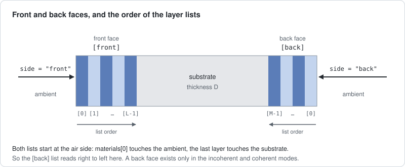
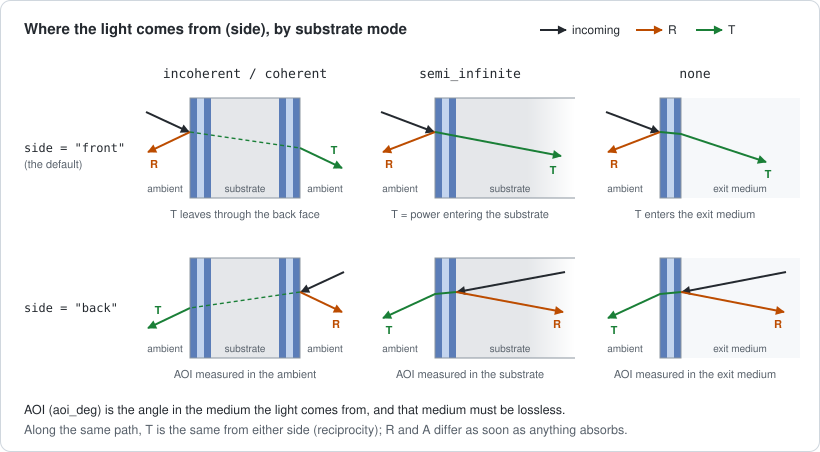

# Interference filter optimization

This project designs multilayer interference filters with thin-film design-software conventions:
- **Specification:** a **target table** of required R, T or A values at given wavelengths and angles of incidence,
  for given polarizations and sides of the filter.
- **Evaluation:** a numerically stable S-matrix engine (JAX, complex128).
- **Optimization:** layer thicknesses, using a multi-start gradient search followed by an L-BFGS-B polish.
- **Cross-checks:** tmmax and Byrnes' `tmm`.

Included examples:
- the 45° two-source **beam combiner** from `system.xml` (sources on opposite faces; ports left = {T@1, R@2} and
  up = {R@1, T@2});
- a **normal-incidence dichroic** with wavelength bands, on a semi-infinite substrate (substrate "off").

The physics behind the calculation is summarized under [Physics model](#physics-model). The design rationale and
measured numbers are in [docs/DESIGN.md](docs/DESIGN.md). The numerical-stability evidence is
in [results/stability/stability_report.md](results/stability/stability_report.md).

## Setup

```bash
/opt/homebrew/Caskroom/miniconda/base/bin/python3.14 -m venv .venv
```

```bash
.venv/bin/python -m pip install -e ".[test]"
```

tmmax is pinned to GitHub commit `dc4b904`. **PyPI tmmax 1.1.4 returns wrong R/T for stacks with two or more layers.**

## Python API

```python
import ifopt as fo

b1 = fo.Beam("1", wavelength_nm=532, aoi_deg=45, side="front", polarization="s")
b2 = fo.Beam("2", wavelength_nm=1064, aoi_deg=45, side="back", polarization="s")
system = fo.FilterSystem(
    substrate=fo.Substrate("FusedSilica", mode="incoherent", thickness_mm=1.0),
    front=fo.Coating(fo.alternating("TiO2", "FusedSilica", 15), bounds_nm={"default": (5, 400)}),
    targets=[b1.eq("T", 1.0, name="T1"), b2.eq("R", 1.0, name="R2")],
)                                                   # or fo.FilterSystem.from_toml("config/combiner_45.toml")

ev = fo.evaluate(system, fo.Design.quarter_wave(system))     # Evaluation: beams, targets, merit, sums
opt = fo.optimize(system, settings=fo.OptimizerSettings(n_starts=64))
opt.design.save("best.json", system)
variant = system.replace(substrate=fo.Substrate("FusedSilica", mode="semi_infinite"))   # validated copy
spec = fo.spectrum(system, opt.design, wavelengths_nm=range(450, 1201), aoi_deg=45)
fig = fo.plot_spectra(system, opt.design)                    # matplotlib Figure
system.to_toml("my_system.toml")
```

| Object / function | Purpose |
|---|---|
| `FilterSystem`, `Substrate`, `Coating`, `Target`, `Beam`, `Objective`, `OptimizerSettings`, `ReportSum` | Frozen spec objects, validated at construction. Vary them with `.replace(...)`. Use `from_toml`/`from_dict` to load and `to_toml`/`to_dict` to save. |
| `MaterialLibrary` (`add_constant`, `add_sellmeier`, `add_table`, `add_csv`), `ConstantMaterial`, ... | Materials. A `Material` object can also be placed directly in a `Coating`, and it is registered automatically. |
| `Design` (`quarter_wave`, `from_system`, `from_x`, `x`, `save`, `load`) | Layer thicknesses of the front coating (and back coating, if any). |
| `evaluate` → `Evaluation` | R/T/A per beam, target results, merit/MF, sums, fringe envelope, ceiling, engine cross-check. Also `.report()`, `.to_dict()`, `.to_pandas()`. |
| `optimize` → `OptimizationResult` | Multi-start Adam followed by L-BFGS-B. Pass `start=` for extra starting designs and `settings=` to override the optimizer settings. |
| `spectrum`, `beam_spectrum`, `angle_scan` → `Spectrum` | Sweeps on any wavelength or AOI grid. |
| `monte_carlo` → `MonteCarlo` | Robustness to thickness errors. |
| `stack_rt` | R/T of a hand-written stack, without building a system. |
| `plot_spectra`, `plot_stack`, `plot_convergence`, `save_plots` | Figures. |

**Library behavior:**
- **Logging:** ifopt never prints. It logs through `logging.getLogger("ifopt")` and is silent by default. Call `fo.enable_logging()` to see optimizer progress.
- **Precision:** importing ifopt turns on JAX 64-bit mode. API calls also force it while they run, so results are always float64 NumPy arrays.

The scripts in `examples/` show the API in use:
- `scripted_combiner.py` builds the combiner in code and checks that it equals the TOML config;
- `parameter_sweep.py` re-optimizes the bands filter over AOI and substrate models and prints a pandas table;
- `quick_stack.py` evaluates a hand-written quarter-wave mirror.

## Command line

```bash
.venv/bin/ifopt evaluate --config config/combiner_45.toml
```

```bash
.venv/bin/ifopt optimize --config config/combiner_45.toml --out results/combiner_45
```

```bash
.venv/bin/ifopt optimize --config config/normal_dichroic_bands.toml --out results/normal_dichroic_bands
```

```bash
.venv/bin/ifopt evaluate --config config/combiner_45.toml --design results/combiner_45/design.json
```

```bash
.venv/bin/ifopt stability --config config/combiner_45.toml
```

```bash
.venv/bin/python -m pytest -q
```

- **Logging options:** `-v` (debug), `-q` (warnings only) and `--log-file PATH` work on every command. `python -m ifopt ...` is equivalent to `ifopt`.
- **Old scripts:** `scripts/compute_rt.py`, `optimize_filter.py` and `stability_study.py` remain as shims for `ifopt evaluate`, `ifopt optimize` and `ifopt stability`.
- **`evaluate`** works on a saved `design.json`, the thicknesses given in the config, or the quarter-wave seed. It prints R/T/A per beam, the engine differences, the fringe envelope and ceiling, the target table, the merit and the sums.
- **`optimize`** writes `design.json`, `report.txt` (with a thickness Monte Carlo) and the plots. `--starts`, `--steps` and `--global-de` override the optimizer settings.

## Config schema

```toml
[system]
ambient = "Air"

[substrate]
material = "FusedSilica"
mode = "incoherent"            # incoherent | coherent | semi_infinite | none
thickness_mm = 1.0             # incoherent / coherent
exit_medium = "Air"            # mode = "none" (default: ambient)

[front]                        # coating on the front face; layers listed from the ambient inward (Figure 1)
materials = ["TiO2", "FusedSilica", "TiO2"]
thickness_nm = [100, 180, 100] # optional: design to evaluate / extra starting point
optimize = true
[front.bounds_nm]
default = [5.0, 400.0]         # per-material keys allowed, e.g. TiO2 = [10, 300]

[back]                         # optional, plate modes only; optimize = false needs thickness_nm
materials = ["FusedSilica", "TiO2"]  # also listed from the ambient inward: materials[0] is the outermost layer
```



**Figure 1.** `[front]` and `[back]` are the coatings on the plate's two faces. Both lists start at the air side, so
across the plate the `[back]` list appears reversed: ambient | front[0] … front[L-1] | substrate | back[M-1] … back[0] |
ambient.

```toml
[[targets]]                    # one row per requirement
name = "pass"                  # unique
beam = "pass"                  # operating condition label (default: name); rows on one beam share it
side = "front"                 # where the light comes from: front | back (Figure 2)
wavelength_nm = [520, 545]     # scalar, explicit list, or [start, stop] with points = N
points = 26
aoi_deg = 0.0                  # scalar or [start, stop] with aoi_points = N; in the medium the light comes from
polarization = "unpolarized"   # s | p | unpolarized | both | azimuth in degrees (0 = p, 90 = s)
quantity = "T"                 # R | T | A
kind = "min"                   # eq | min (lower bound) | max (upper bound)
value = 0.98
tolerance = 1.0                # deviation is divided by this
weight = 1.0                   # per row, split over its expanded points

[objective]
form = "power"                 # power: MF = (sum w |d|^p / sum w)^(1/p) | minimax | log
power = 2

[[report.sums]]                # optional, e.g. output ports
name = "left port"
terms = ["T@1", "R@2"]         # quantity@beam (single-point beams)

[optimizer]                    # n_starts, adam_steps, adam_lr, top_k, seed, global_de, de_maxiter, de_popsize

[[materials.custom]]           # type = constant (n, k) | sellmeier (B, C) | csv (path: wavelength_nm,n,k)
```

| Substrate mode | Stack | Use |
|---|---|---|
| `incoherent` | ambient \| front \| thick substrate \| back \| ambient | real plates; reports the fringe envelope and back-face ceiling |
| `coherent` | same, with the substrate as an etalon at its physical phase | single-frequency analysis |
| `semi_infinite` | ambient \| front \| substrate | substrate "off": back surface ignored, no fringes |
| `none` | ambient \| front \| exit medium | free-standing stack |



**Figure 2.** `side` says where the light comes from:
- **`front`** (the default): from the ambient onto the front coating.
- **`back`:** onto the back coating in the plate modes, or from inside the substrate or exit medium in the stack modes.

The AOI is measured in the medium the light comes from. A back-side 45° in `semi_infinite` mode is therefore 45°
inside the glass. On fused silica that is past the critical angle (about 43–44°), so the light is totally reflected.

## Examples

| Config | What it shows | Result (`results/<config>/`) |
|---|---|---|
| `combiner_45.toml` | 45° combiner, maximize T1 and R2, bare back face | T1 = 0.917358 (bare-face ceiling), R2 = 0.999629 |
| `combiner_45_up_port.toml` | maximize R1 and T2 | R1 = 0.999839, T2 = 0.919968 |
| `combiner_45_back_ar.toml` | plus an optimized 4-layer back-face AR | T1 = 0.999998, R2 = 0.999730 |
| `combiner_45_back_ar_sp.toml` | targets for s and p (`polarization = "both"`) | T1 ≥ 0.9972, R2 ≥ 0.9924 |
| `normal_dichroic_bands.toml` | 0°, wavelength bands, one-sided targets, semi-infinite substrate | pass band T ≥ 0.9892, reflect band R ≥ 0.99975 |

Custom nk tables go in `materials/<Name>.csv`, with the columns `wavelength_nm,n,k`.

## Physics model

ifopt treats a filter as flat, uniform layers hit by a plane wave of one wavelength. Its central assumption is that the
thin layers interfere coherently while the thick substrate does not. It computes the reflected, transmitted and
absorbed power fractions (R, T, A), then adjusts the layer thicknesses until those fractions match the target table.

### Assumptions

- **Geometry:** the coatings are stacks of homogeneous, isotropic layers with flat, parallel interfaces. Roughness,
  scattering, graded interfaces and birefringence are not modelled.
- **Materials:** each material has a complex refractive index N = n + ik as a function of wavelength. k ≥ 0 is the
  absorption. The values come from tables or Sellmeier fits ([materials.py](src/ifopt/materials.py)).
- **Light:** a monochromatic plane wave with wavelength λ, angle of incidence θ₀ and polarization s or p. A spectrum is
  this calculation repeated at many wavelengths.

### Waves inside the layers

The wavevector component parallel to the interfaces is the same in every layer (phase matching, which is Snell's law).
In units of k₀ = 2π/λ:

```
kx  = n₀ sin θ₀                        (fixed through the whole stack)
q_j = √(N_j² − kx²) = N_j cos θ_j      (normal component in layer j)
```

In each layer the field is a forward wave plus a backward wave, e^{±i·k₀·q_j·z}. The square root has two solutions. The
engine takes the one with Im q ≥ 0, so the forward wave decays as it travels. That is the physical choice for absorbing
layers and for evanescent waves beyond total internal reflection (`kz` in
[stable_engine.py](src/ifopt/engines/stable_engine.py)).

### Interfaces and layer phases

**Interfaces** follow the Fresnel equations, which express continuity of the tangential E and H fields:

```
s:  r = (q_i − q_j)/(q_i + q_j)                       t = 2q_i/(q_i + q_j)
p:  r = (N_j²q_i − N_i²q_j)/(N_j²q_i + N_i²q_j)        t = 2N_iN_jq_i/(N_j²q_i + N_i²q_j)
```

The N² factors in the p formulas produce Brewster's angle; the tests check that p-reflectance is zero there.

**Crossing a layer** of thickness d multiplies the amplitude by e^{iδ}, where δ = 2π·q·d/λ.
- Re δ is the phase. It sets the interference: a quarter-wave layer (δ = π/2) makes reflections from its two faces add
  in phase, and a half-wave layer (δ = π) is optically absent at its design wavelength.
- Im δ is the absorption: |e^{iδ}| = e^{−Im δ} ≤ 1.

All filter behaviour follows from these two building blocks:
- **Mirrors:** quarter-wave (HL)^p stacks are mirrors with a stop band of half-width
  (2/π)·asin((n_H − n_L)/(n_H + n_L)), in relative frequency.
- **Bandpass:** a half-wave spacer between two mirrors is a Fabry–Pérot resonator. Coupling several of them gives a
  flat-topped bandpass.
- **Edge filters:** (L/2 H L/2)^q and (H/2 L H/2)^q stacks are edge filters, used for blocking outside a passband.

### Adding up the multiple reflections

Each interface or layer is described by four amplitudes: reflection and transmission from each side (r, t, r′, t′).
Two elements A and B are joined with the Redheffer star product:

```
r_AB = r_A + t′_A · r_B · t_A / (1 − r′_A · r_B)
t_AB = t_A · t_B / (1 − r′_A · r_B)
```

The denominator 1/(1 − r′_A·r_B) is the geometric series of the light bouncing back and forth between A and B. Each
term is a real sequence of bounces, and its size never exceeds 1.

The more common transfer-matrix method (used by tmmax and Byrnes' `tmm`) also has to carry the growing exponential
e^{+Im δ}. In thick absorbing stacks that overflows: float32 fails at a total Im δ of about 89, and float64 at about
709. The S-matrix method only multiplies by the decaying factor, so it handles any thickness and any amount of loss.
That is why it is the default engine; the evidence is in
[results/stability/stability_report.md](results/stability/stability_report.md).

### From amplitudes to power

R and T are ratios of the power flux normal to the surface (the Poynting vector), not just |amplitude|²:

```
R = |r|²
T = |t|² · Re(q_out)/Re(q_in)                                        (s)
T = |t|² · Re(N_out·conj(q_out/N_out)) / Re(N_in·conj(q_in/N_in))     (p)
A = 1 − R − T        (energy conservation: power absorbed in the layers)
```

The tests check two physical facts:
- **No loss:** R + T = 1 for a lossless stack.
- **Reciprocity:** T is the same in both directions. R and A depend on the side as soon as something absorbs, because
  an absorbing layer near the incident side affects reflection differently from one far from it.

**Polarization:** s and p are computed separately and mixed afterwards. Unpolarized light is their average. A
polarization azimuth ψ uses the weights (sin²ψ, cos²ψ), with 0° = p. At normal incidence s and p are identical, and a
test checks this in every substrate mode.

### The substrate

A 1 mm substrate is itself a Fabry–Pérot etalon. Its fringe spacing is Δλ = λ²/(2nD):
- about 0.1 nm at 532 nm for fused silica;
- about 12.5 nm at 10 µm for Ge.

Thermal sources, broadband detectors and multimode lasers average over these fringes, so the `incoherent` mode adds
intensities, not amplitudes ([plate.py](src/ifopt/plate.py)). Each coated face is first solved coherently between the
ambient and the substrate, giving R_a, T_a, R′_a (as seen from inside) and the same for the back face b. Then the
incoherent bounces inside the plate are summed:

```
R = R_a + T_a·T′_a·R_b·τ² / (1 − R′_a·R_b·τ²)
T = T_a·T_b·τ / (1 − R′_a·R_b·τ²)
τ = exp(−4π·D·Im q_sub/λ)        (one-pass internal power transmittance)
```

**Two exact consequences:**
- **The incoherent result is the average of the coherent ones.** It equals the coherent plate's result averaged over
  the substrate phase. ifopt uses this for the **fringe envelope**: it scans that phase and reports the minimum and
  maximum R and T that a single-frequency laser could see.
- **The back face limits transmission.** No passive front coating can push T above T_back·τ. That is why the
  bare-back combiner stops at T1 = 0.917.

| Mode | What it represents |
|---|---|
| `incoherent` | A thick plate, using the intensity sum above |
| `coherent` | The substrate as a real etalon at its physical phase |
| `semi_infinite` | Substrate "turned off": T is the power entering the glass, with no back surface |
| `none` | A free-standing stack between the ambient and an exit medium |

### Optimization

- **Targets:** each row of the target table asks for a physical quantity (R, T or A) at a wavelength, angle and
  polarization, on the front or back side.
- **Merit:** a weighted sum of the deviations from those targets.
- **Gradients:** JAX differentiates through the whole calculation, so the optimizer gets exact derivatives of R and T
  with respect to every layer thickness.
- **What changes:** only the thicknesses. The refractive indices are fixed by the material data.
- **Starting point:** quarter-wave stacks, the textbook starting designs.
- **Search:** Adam explores from many starting designs at once, then L-BFGS-B refines the best ones. Both use 64-bit
  floats, which keeps the gradients accurate.

### Not modelled

- Scattering, roughness, interdiffusion, porosity or water uptake in films.
- Birefringence.
- Partial coherence: a substrate is either fully coherent or fully incoherent, with nothing in between that depends on
  the source bandwidth.
- Beam divergence: each point has one angle, not a cone of angles.
- Lateral beam offset: in the 45° combiner the two reflections leave the plate about 0.8 mm apart, but they are
  summed as one beam.
- Temperature: the optical constants are taken at the temperature of the material data.

## Layout

| Path | Purpose |
|---|---|
| `src/ifopt/api.py` | Public operations and result types (`evaluate`, `optimize`, `spectrum`, `monte_carlo`, `stack_rt`, report) |
| `src/ifopt/cli.py` | `ifopt` command (`evaluate`, `optimize`, `stability`), logging setup |
| `src/ifopt/design.py`, `io.py` | `Design` (thicknesses, design.json); TOML writer |
| `src/ifopt/targets.py` | `Target`, `Beam`, resolution, expansion, deviations |
| `src/ifopt/config.py` | `FilterSystem` and spec objects, validation, dict/TOML round trip, design vector |
| `src/ifopt/plate.py` | Substrate modes, evaluation `Model`, fringe scan, back-face ceiling, engine cross-check |
| `src/ifopt/engines/` | S-matrix (default), tmmax adapter, Byrnes reference |
| `src/ifopt/objectives.py`, `optimizer.py` | Merit forms, quarter-wave seed, vmapped Adam → L-BFGS-B, optional DE |
| `src/ifopt/analysis.py`, `plotting.py` | Spectra and Monte Carlo computations; Figure-returning plots |
| `src/ifopt/stability.py` | Numerical-stability study (`ifopt stability`) |
| `src/ifopt/materials.py` | Material library; raises outside the tabulated range |
| `src/ifopt/geometry.py` | `system.xml` port mapping (combiner tests) |
